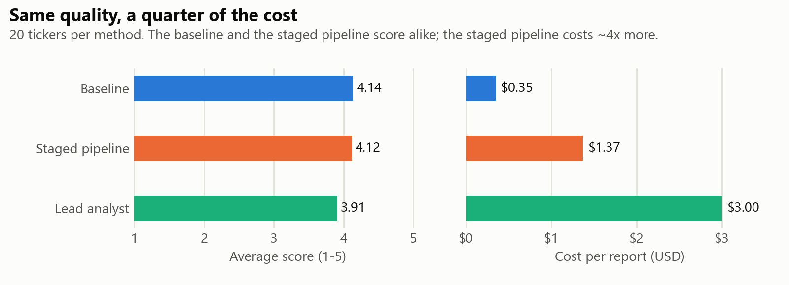
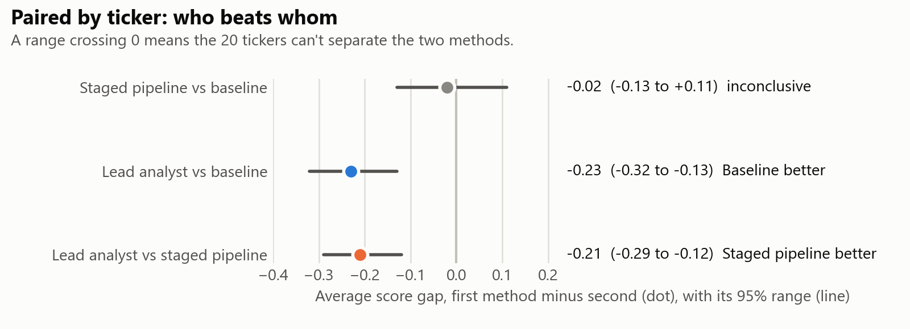
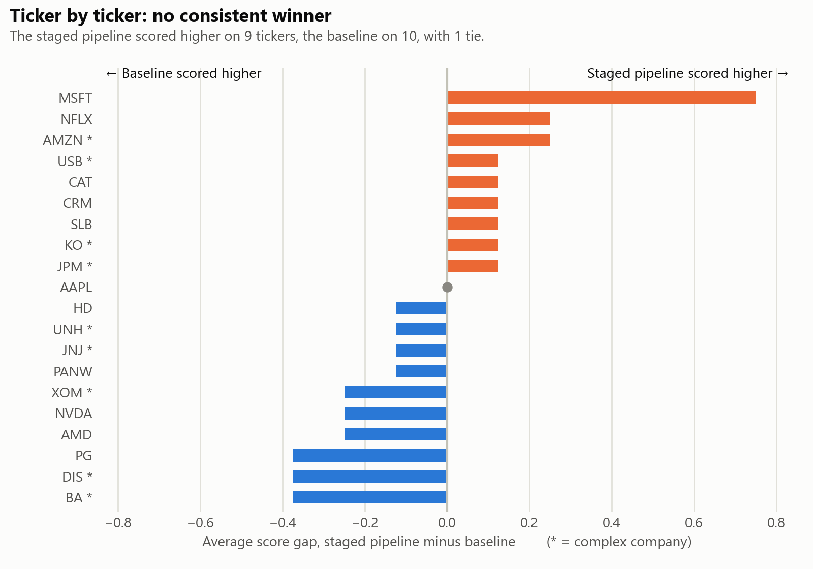
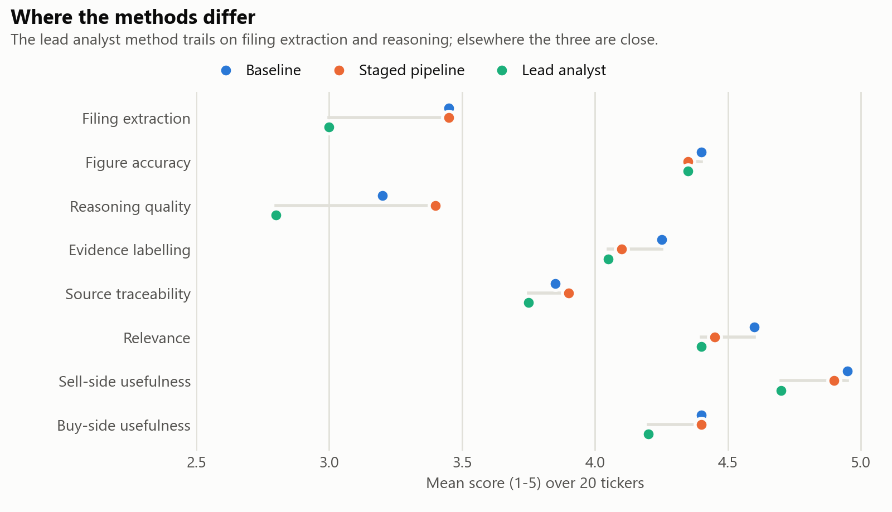

# Yoda: Can an Agentic AI System Beat a Single LLM Call?

Yoda is an experiment in pre-earnings equity research. **The question: does a multi-step, agentic LLM system write better research than a single LLM call given the same sources, and is it worth the extra cost?** To answer it, Yoda writes a citation-checked pre-earnings report for a US-listed stock three different ways, from its SEC filings, latest earnings call, market expectations and recent news, and an independent judge scores them. Every statement in a report cites the source passages behind it, and code checks each citation before the report is saved. Yoda also works as a tool: a Streamlit app produces the report on screen and as a PDF.

## At a glance

| | |
|---|---|
| **Question** | Does an agentic system beat one LLM call at the same task, by enough to justify its cost? |
| **The task** | Before each earnings report, an analyst spends 60–90 minutes per ticker assembling the latest filing's figures, guidance, consensus and news, tab by tab. |
| **What was built** | Three ways to write the report from identical sources: a one-call **baseline**, and two agentic designs, a multi-stage **staged pipeline** and a team-style **lead analyst method**. |
| **How it was tested** | 3 methods × 20 tickers (two per sector). Each report was scored 1–5 on 8 dimensions by a judge from a different model family, which read the same evidence the writer had. Comparisons are paired ticker by ticker, with 95% bootstrap ranges, and the complexity labels were fixed before any report was written. |
| **Answer** | **No, not on this evidence.** The better agentic design, the staged pipeline, scored the same as the one-call baseline (average gap −0.02, 95% range −0.13 to +0.11) at about **4 times the cost** ($1.37 against $0.35 per report). The other, the lead analyst method, scored **below** the baseline and cost the most ($3.00 per report). |
| **Decision** | The lead analyst method is not adopted. Yoda keeps two modes: the **baseline**, which gives the same measured quality at about a quarter of the cost, and the **staged pipeline**, which has a second model check every claim against its sources. The full run cost about $108 in API fees. |

<picture>
  <source media="(prefers-color-scheme: dark)" srcset="docs/charts/quality_vs_cost-dark.png">
  
</picture>

*Average score over the eight rubric dimensions (left; bars start at 1, the lowest possible score) and generation cost per report (right), 20 tickers per method. The baseline and the staged pipeline are a statistical tie in quality; the baseline costs a quarter as much.*

Full results are in [section 2](#2-results-full-evaluation-2026-11-01), the design in [docs/architecture.md](docs/architecture.md), and the raw outputs (all 60 reports, the evidence each writer had, costs and judge scores) in [`data/eval/full/`](data/eval/full/).

---

## Contents

1. [The problem and the user](#1-the-problem-and-the-user)
2. [Results: full evaluation (2026-11-01)](#2-results-full-evaluation-2026-11-01)
3. [How Yoda works](#3-how-yoda-works)
4. [Evaluation method](#4-evaluation-method)
5. [Setup and usage](#5-setup-and-usage)
6. [Repo overview](#6-repo-overview)
7. [Project documents](#7-project-documents)

---

## 1. The problem and the user

**Who:** a buy-side or sell-side analyst who covers 10–50 tickers and prepares for each earnings call in the week or two before it.

**The workflow:** before every earnings call, the analyst reads the most recent 10-Q or 10-K, pulls consensus estimates, scans recent news, and assembles a short dossier: the figures to model, guidance, what has changed since the filing, the key debates and the questions for management.

**Why it matters:** the bottleneck is assembly time, not judgment: finding the right filing section, locating a guidance quote, cross-checking a figure against the call. Automating the citation-backed assembly frees the analyst for the part that is genuinely interpretive.

**The failure mode Yoda is built against:** generic LLM summaries invent figures and drop citations, and an analyst can't use a report that might be fabricated. In Yoda every statement is a *claim* that cites evidence IDs (for example `Q.042`, a passage of the 10-Q). Code removes any ID that doesn't exist, and anything the writer couldn't cite goes into a visible `data_gaps` list instead of being invented.

---

## 2. Results: full evaluation (2026-11-01)

3 methods × 20 tickers = 60 reports, all generated and all judged. No report failed.

### The verdict: who beats whom

| Comparison | Verdict | Tickers won / tied / lost |
|---|---|---|
| Staged pipeline vs baseline | **Tie.** The data can't separate them. | 9 / 1 / 10 |
| Lead analyst vs baseline | **Baseline better** | 2 / 1 / 17 |
| Lead analyst vs staged pipeline | **Staged pipeline better** | 2 / 1 / 17 |

<picture>
  <source media="(prefers-color-scheme: dark)" srcset="docs/charts/paired_gaps-dark.png">
  
</picture>

*Each row compares two methods on the same 20 tickers. The dot is the average score gap (first method minus second), and the line is its 95% bootstrap range. A line crossing the vertical 0 line means the difference could be noise. The dot takes the colour of the winning method, and grey when there is no winner.*

### Ticker by ticker

<picture>
  <source media="(prefers-color-scheme: dark)" srcset="docs/charts/per_ticker_gaps-dark.png">
  
</picture>

*Each bar is one ticker's average score gap, staged pipeline minus baseline. Orange bars are tickers where the staged pipeline scored higher, blue bars where the baseline did, and grey marks a tie. There is no pattern by company complexity (\* = complex). Apart from MSFT, each gap is 1 to 3 points spread over the eight dimensions (a gap of 0.125 is one dimension differing by one point).*

### Where the methods differ

<picture>
  <source media="(prefers-color-scheme: dark)" srcset="docs/charts/dimension_scores-dark.png">
  
</picture>

*Mean score on each of the eight rubric dimensions, over 20 tickers. The two widest spreads are filing extraction and reasoning quality, where the lead analyst method trails. Sell-side usefulness sits near the top of the scale for every method, which leaves little room to tell them apart.*

<details>
<summary><b>All scores as a table</b></summary>

| Method | Filing extraction | Figure accuracy | Reasoning | Evidence labelling | Traceability | Relevance | Sell-side use | Buy-side use | **Average** | Cost / report | Time / report |
|---|---|---|---|---|---|---|---|---|---|---|---|
| Baseline | 3.45 | 4.40 | 3.20 | 4.25 | 3.85 | 4.60 | 4.95 | 4.40 | **4.14** | **$0.35** (batched) | one call |
| Staged pipeline | 3.45 | 4.35 | 3.40 | 4.10 | 3.90 | 4.45 | 4.90 | 4.40 | **4.12** | $1.37 | 370 s |
| Lead analyst | 3.00 | 4.35 | 2.80 | 4.05 | 3.75 | 4.40 | 4.70 | 4.20 | **3.91** | $3.00 | 556 s |

| Comparison | Average gap | 95% range | Won / tied / lost |
|---|---|---|---|
| Staged pipeline − baseline | −0.02 | −0.13 to +0.11 | 9 / 1 / 10 |
| Lead analyst − baseline | −0.23 | −0.32 to −0.13 | 2 / 1 / 17 |
| Lead analyst − staged pipeline | −0.21 | −0.29 to −0.12 | 2 / 1 / 17 |

Per-dimension gaps, judge details and every justification: [`data/eval/full/rescore/summary.md`](data/eval/full/rescore/summary.md). The charts are drawn from `results.csv` by [`docs/charts/make_charts.py`](docs/charts/make_charts.py), which uses the eval runner's own statistics functions.

</details>

### By company complexity

| Group | Lead analyst − staged pipeline | Won / tied / lost |
|---|---|---|
| Complex (9 tickers) | −0.19 (sign test p = 0.07) | 1 / 1 / 7 |
| Simple (11 tickers) | −0.23 (95% range −0.33 to −0.10) | 1 / 0 / 10 |

*Complexity labels were fixed before any report was written ([`yoda/eval/complexity.py`](yoda/eval/complexity.py)). The idea that a lead-and-workers design pays off on complex companies was not supported: it trailed on both groups.*

### What the results mean

- **The staged pipeline's extra stages bought no measurable quality.** Two extractors, two research loops, a claim check and a repair pass scored the same as one call over the same sources. Its 95% range sits tightly around zero, so a large hidden advantage is unlikely on this rubric. At about 4 times the cost per report, the baseline is the better value.
- **The lead analyst method lost on two dimensions in particular:**
  - **Filing extraction** (−0.45 against both other methods; it won on no ticker). Writing around 4–6 chosen questions appears to crowd out the routine latest-quarter figures the rubric expects.
  - **Reasoning quality** (−0.60 against the staged pipeline; again no wins). The judge's justifications repeatedly say its conclusions went further than the evidence. One example: a report claimed an iPhone figure below a chosen threshold would signal weak demand rather than constrained supply, while the evidence said supply was constrained.
- **The claim check catches real problems, but the rubric didn't reward fixing them.** In the candidate methods' first drafts, two models agreed that about 11% of the staged pipeline's claims (7.8 of 71.5 per report) and 14% of the lead analyst method's were not supported by the passages they cited. Those claims were rewritten or removed. The baseline has no such check, yet its figure accuracy and traceability scores were no lower. Either its claims overreach less, or the judge doesn't catch this kind of overreach ([limitations](#limitations-of-this-evaluation)).
- **The judge did not reward length.** A report's length had a negative or near-zero rank correlation with every score (−0.36 to +0.12).

### Cost against estimates

| | Estimate | Actual |
|---|---|---|
| Anthropic (generating reports) | $95–120 from the smoke run; $106.50 scaled by each ticker's source size; about $95 after the cache savings | **$94.48** (baseline $7.06, staged pipeline $27.38, lead analyst $60.03) |
| OpenAI (judging) | about $13 expected, $42 worst case | **$13.62** (batch A $8.14, batch B $5.48) |
| Tavily (news search) | about 600 credits, up to 980 | about 330 per 10 tickers (batch A measured: 329) |
| Paid whisper lookups | $0 expected | **$0** |
| **Total** | | **about $108** plus Tavily credits |

Per report: baseline $0.35, staged pipeline $1.37, lead analyst $3.00, and judging about $0.23. The staged pipeline came in 21% under the smoke run's $1.74 per report, mostly because the shared sources moved from a 1-hour cache (written at 2 times the input price) to a 5-minute cache kept alive by re-reads (written at 1.25 times). None of the 40 candidate reports had a keep-alive miss.

### Time against estimates

| | Estimate | Actual |
|---|---|---|
| Generating batch A (10 tickers) | about 3 hours | 2 hours 37 minutes |
| Generating batch B (10 tickers) | about 3 hours | about 2 hours 36 minutes |
| Generating all 20 tickers | 5–6 hours | **about 5 hours 13 minutes**, about 15.6 minutes per ticker |
| Judging | 50–60 minutes | **45 minutes** (24 + 21) |

Average time per report: staged pipeline 370 s, lead analyst 556 s. The baselines ran as one batch alongside the others, so they added no waiting time.

### How the run was made safe to spend on

- **A free dry test first.** All 20 tickers' sources were fetched with every paid call switched off, every prompt was checked against the context window, every API key was tested, and the offline test suite passed (595 tests).
- **Two batches of 10**, split by sector pair so each half covered every sector. Batch A's costs and cache behaviour were checked before batch B was started.
- **A judge budget.** Judging stops before any call whose worst-case cost could pass the budget given on the command line.

### Run reliability

- 60 of 60 reports generated, 60 of 60 judged, and every judge call stopped normally.
- **Minor issues:**
  - One staged pipeline report (KO) couldn't download a competitor's newest 10-Q (SEC returned an error).
  - The claim check couldn't answer for 6 claims in 5 reports; they are labelled "not checked" in those reports, not removed.
  - In 3 of 480 scores, the judge's quote couldn't be found in the report or evidence. The scores are kept and flagged.
- **Data gaps, the same for every method:**
  - FMP's free plan refuses analyst grades for 7 tickers (HD, USB, SLB, PG, CAT, PANW, CRM).
  - Alpha Vantage has no recent call transcript for HD or CRM.
  - MSFT, XOM and PG used the previous quarter's call.

### Limitations of this evaluation

- **One LLM judge, not yet checked against human scores.** The judge is from a different model family (OpenAI, while the writers are Claude) and must quote the passages behind each score, but no human has yet hand-scored a sample to confirm that its scores track expert judgment.
- **Ceiling effects.** Sell-side usefulness averaged 4.70–4.95 out of 5, and several dimensions had 15–17 ties out of 20. The rubric has limited room to separate good reports from very good ones.
- **20 tickers, one point in time** (reports written 2026-11-01), all large US companies.
- **The judge scores report quality, not value to a user.** It can't measure whether a report saves an analyst time or changes a decision.

### How the result changed from the smoke run

A 5-ticker smoke run on 2026-10-31 had the staged pipeline ahead of the baseline (+0.44 on the then nine-dimension rubric, winning on 5 of 5 tickers). It did not hold at 20 tickers. The likely reason is that the smoke run's baseline used a news search that ignored its date window: it got 2 results and cited none. That was fixed before the full run (it now gets 10 in-window results), and a stronger baseline closed the gap. This is why the smoke result was read only as a direction, and why the full run was run at all.

### Earlier history

On 2026-10-26 a retired architecture (a multi-agent "personality panel") lost to an older, filing-only baseline (−0.57; 1 win, 2 ties, 17 losses of 20) on a five-dimension rubric whose judge saw only the first 30,000 characters of the filing. That result led to the current rubric, the shared sources, the evidence store and the two candidate methods. Those reports are archived in [`data/eval/archive_2026-10-26_claude-panel_old-rubric/`](data/eval/archive_2026-10-26_claude-panel_old-rubric/).

---

## 3. How Yoda works

### Two modes

| | Baseline | Staged pipeline |
|---|---|---|
| **What it does** | One Claude Sonnet 5.5 call over the shared sources plus one generic news search ("&lt;company&gt; &lt;ticker&gt; earnings", last 14 days) | A filing extractor and a post-filing extractor (Sonnet 5.5) and two research loops for news and competitors (Haiku 5.5) feed one writer (Sonnet 5.5). Then every claim is checked against its passages by two models, and one repair pass follows. |
| **Claim checking** | Code checks that every cited ID exists | Code checks IDs, **and** Haiku 5.5 reads each claim beside its cited passages, with a Sonnet 5.5 second opinion before anything is removed |
| **Cost per report** (full evaluation) | **$0.35** through the Batch API ($0.71 as a single call) | **$1.37** |
| **Time per report** | One call (batched reports return within the hour) | About 6 minutes |
| **Measured quality** | Average 4.14 / 5 | Average 4.12 / 5 (not distinguishable from the baseline) |
| **Where it runs today** | Command line (`python -m yoda.modes.baseline TICKER`) and the eval runner | The Streamlit app (single ticker and queue), the command line and the eval runner |

A switch between the two modes inside the app is planned (next_steps item 3). Today the app always uses the staged pipeline. The lead analyst method (`yoda/modes/lead.py`) stays in the repo so the evaluation can be reproduced, but no user-facing mode uses it.

### The shared sources

Every method reads the same sources, fetched once per ticker by [`yoda/sources.py`](yoda/sources.py), within one length limit:

- **SEC filings** (`yoda/ingest/edgar.py`): the most recent 10-Q (filed in the last 18 weeks) and/or annual report (10-K, or a foreign company's 20-F or 40-F, filed in the last 13 months). If a company took over its ticker from another company in a reorganisation (XOM in 2026), the predecessor's annual report is found and read.
- **The latest 8-K** (or a foreign company's 6-K) filed after the newest filing.
- **The XBRL fact sheet** (`yoda/ingest/xbrl.py`): the filings' tagged headline figures as citable rows.
- **The latest earnings call** (`yoda/ingest/transcripts.py`, from Alpha Vantage), speaker by speaker.
- **The market snapshot** (`yoda/tools/consensus.py`): consensus estimates (Finnhub, with FMP as backup), the whisper number (free from Earnings Whispers' preview articles, with a paid search as fallback), the options-implied move, the historical earnings-day move, the beat/miss record, analyst actions and the price target.

### Cite or skip

The evidence store (`yoda/evidence_store.py`) cuts every source into passages with short, stable IDs: `Q.001` 10-Q, `K.001` annual report, `E.001` 8-K, `C.001` call, `F.01` fact sheet, `M.01` market data, `N.01` news, `A.001` article, `P.001` competitor filing. The writer cites IDs, and after writing, code (`yoda/report/checks.py`):

1. removes any ID that isn't in the evidence the writer had, and adds a data gap naming the claim;
2. removes news older than 14 days as a citation (it can be background, never evidence);
3. marks a claim left with no ID as unverifiable;
4. downgrades an evidence tag that claims more than its sources allow (a "reported" figure backed only by news becomes an estimate);
5. records every change in the report's check notes.

Fields that must not be invented are filled by code, never by the model: which filings, call and 8-K were read, and the market's expectations (`yoda/report/header.py`).

### The report

A report (`EarningsReport` in [`yoda/schema.py`](yoda/schema.py)) has these sections: setup summary, metrics to model (last reported, consensus and a view, for each metric), market expectations, guidance, since the filing, key debates, scenarios, key risks, questions for management, data gaps, and the sources with readable citations and links. An example claim from a real report (AAPL, staged pipeline):

```json
{
  "text": "Fiscal Q3 (June quarter) was strong: revenue $109.42B (+16.4% y/y), diluted EPS $2.02 (+28.7%), operating margin 32.6% vs 30.0% a year earlier. ...",
  "evidence_ids": ["F.01", "F.02", "F.37", "F.09", "F.10", "F.41", "F.53", "F.55", "C.048"],
  "evidence_type": "reported"
}
```

The app renders the report on screen and as a PDF (`yoda/report/pdf.py`). Every claim is followed by its evidence type and its sources, linked to the SEC filing, call or article.

### Architecture

See **[docs/architecture.md](docs/architecture.md)** for diagrams of the whole system, each method's stages and the evaluation harness.

### Key design choices

| Choice | Why |
|---|---|
| Identical shared sources for every method | A score difference then comes from the method, not from what each method was allowed to read |
| Evidence IDs checked by code | A made-up citation can never look checked; anything uncitable becomes a visible data gap |
| Code fills the header and market expectations | Figures that must be exact (what was read, consensus, the implied move) never pass through a model |
| Claim check with two models (staged pipeline) | Haiku 5.5 checks cheaply; a claim is removed only when Sonnet 5.5 independently agrees, so one model's mistake can't delete a good claim |
| Prompt caching with a 5-minute cache and keep-alives | The shared sources are written to Anthropic's cache once per report and read at a twentieth of the input price; it is the main reason the staged pipeline cost 21% less per report than in the smoke run |
| Baselines through the Anthropic Batch API | Half price for a call that doesn't need an immediate answer |
| OpenAI `gpt-6.1-sol` as the judge | A different model family from the Claude writers, so the judge can't favour its own family's style |
| The judge reads the writer's evidence | Every citation and figure can be checked against the passage it names |
| A two-step eval with a judge budget | Reports are generated first; judging is a second command that stops before it could overspend |
| Complexity labels fixed before any report | The complex-versus-simple split can't be chosen after seeing the scores |
| `reportlab` for PDFs | Pure Python; no native libraries needed on Windows |

---

## 4. Evaluation method

### What is compared

| Method | Code | In one line |
|---|---|---|
| Baseline | `yoda/modes/baseline.py` | One call over the shared sources and one news search |
| Staged pipeline | `yoda/modes/pipeline.py` | Fixed stages: extractors, researchers, writer, claim check, repair |
| Lead analyst method | `yoda/modes/lead.py` | A lead picks 4–6 questions, a worker answers each, the lead follows up and writes, then the same claim check |

Nothing another method found (its news, articles or evidence) can reach the baseline (pinned by `tests/test_offline.py`).

### Test set

Twenty US-listed companies, two per sector, the second chosen to be structurally different from the first ([`CURATED_TICKERS` in `yoda/eval/runner.py`](yoda/eval/runner.py)):

| Sector | Tickers |
|---|---|
| Tech: hardware and platforms | AAPL, MSFT |
| Tech: semiconductors | NVDA, AMD |
| Consumer discretionary and retail | AMZN, HD |
| Financials | JPM (money-center bank), USB (regional bank) |
| Healthcare | JNJ (pharma and medtech), UNH (managed care) |
| Energy | XOM (integrated major), SLB (oilfield services) |
| Consumer staples | KO, PG |
| Media and streaming | NFLX, DIS |
| Industrials | CAT, BA |
| Software | PANW (cybersecurity), CRM (SaaS) |

Nine are labelled **complex** (JPM, USB, UNH, XOM, KO, AMZN, JNJ, DIS, BA) and eleven **simple**, fixed in `yoda/eval/complexity.py` before any report was written.

### Rubric

The judge, OpenAI `gpt-6.1-sol` at medium reasoning effort (`yoda/eval/judge.py`), reads the report and the evidence its writer had (`{mode}_{ticker}_evidence.json`). It scores eight dimensions 1–5 against written anchors (`yoda/eval/rubric.py`), and each justification must quote the passages behind its score:

| Dimension | What it measures |
|---|---|
| **filing_extraction** | The latest reported quarter's headline figures and segments, the guidance, new or changed risks and material post-filing 8-Ks |
| **figure_accuracy** | Each checkable figure matches the source it is attributed to |
| **reasoning_quality** | Conclusions follow the evidence; conflicts between sources are flagged and resolved by the agreed rules |
| **evidence_labelling** | Post-filing claims say where they came from, as of when, and whether they are results, outlook or estimates |
| **source_traceability** | Every claim cites evidence IDs that exist and contain the fact |
| **relevance** | Focus on what bears on the upcoming report, not boilerplate |
| **sell_side_usefulness** | Metrics to model against consensus, the guidance that matters, questions for management |
| **buy_side_usefulness** | Whisper against consensus against guidance, implied against historical move, catalysts, a clear setup |

A dimension a method had no evidence for is marked N/A by code and left out of that ticker's comparison. The market-expectations section is not scored: code fills it from data every method shares, so it would measure the code, not the method.

### How results are read

Methods are compared **ticker by ticker** (one method's score minus the other's), so how easy or hard a company is cancels out.

- **10 or more paired tickers: a 95% bootstrap range.** The tickers are resampled with replacement 10,000 times, and the middle 95% of the resampled mean gaps is kept. A range entirely above or below 0 is a real difference; a range crossing 0 means the data can't tell the two apart.
- **Fewer than 10: a sign test** on wins against losses, with ties left out. (At exactly 10 both are shown.)
- **Fewer than 5: no test**, and the summary says so.

### Judge reliability checks

`summary.md` reports each of the following:

- the judge versions OpenAI reported, with a warning when they are mixed;
- calls that didn't stop normally;
- quotes that couldn't be found where they claim to be, by dimension;
- the rank correlation between report length and score.

Judge results are cached by the judge model, the rubric, the N/A list, the report and its evidence, so re-judging an unchanged report is free and a changed rubric is never served old scores.

---

## 5. Setup and usage

### Prerequisites

- Python 3.11+
- API keys for Anthropic, OpenAI, Finnhub, FMP, Tavily and Alpha Vantage (free key), plus a contact string for SEC EDGAR

### Installation

```bash
git clone <repo-url>
cd Yoda
python -m venv .venv
.venv\Scripts\activate          # Windows; on macOS/Linux: source .venv/bin/activate
pip install -r requirements.txt
cp .env.example .env            # then fill in your keys
```

### Required API keys

| Variable | Purpose |
|---|---|
| `ANTHROPIC_API_KEY` | All report writing: Claude Sonnet 5.5 (writers, extractors, the baseline, the claim check's second opinion) and Claude Haiku 5.5 (research loops, the claim check's first pass) |
| `OPENAI_API_KEY` | The eval judge (`gpt-6.1-sol`) and embeddings of competitors' filings (`text-embedding-3-small`) |
| `FINNHUB_API_KEY` | Consensus estimates and the earnings calendar |
| `FMP_API_KEY` | Financial Modeling Prep: backup consensus, analyst grades and price targets |
| `TAVILY_API_KEY` | News search and article reading, 1000 free credits/month |
| `ALPHAVANTAGE_API_KEY` | Earnings call transcripts (free key, about 25 requests a day; transcripts are cached in `data/transcripts/`) |
| `SEC_USER_AGENT` | SEC EDGAR requires a contact string, e.g. `"Your Name you@example.com"` |

Keys are read from `.env` (gitignored); `.env.example` lists every name with an empty value.

### Run the app

```bash
streamlit run app.py
```

Open [http://localhost:8501](http://localhost:8501), enter a ticker and click **Generate Report**. The **Queue** view runs many tickers in turn, saves each PDF to `data/reports/` and bundles them into a ZIP.

Before searching, the app checks the ticker's next earnings date (a free call) and looks for the whisper number, free, in Earnings Whispers' preview article. Only when that finds nothing does it ask you to **Allow spend** or **Disallow** a paid Claude search for the whisper (about $0.12–0.15).

### Run one mode from the command line (paid)

```bash
python -m yoda.modes.baseline NVDA      # about $0.71 as a single call
python -m yoda.modes.pipeline NVDA      # about $1.40
python -m yoda.modes.lead NVDA          # about $3.00 (evaluation only)
python -m yoda.report.pdf NVDA pipeline # PDF from a saved report, free
```

Each writes `{mode}_{TICKER}.json` (and its evidence) to `data/eval/`.

### Run the evaluation (paid)

Two commands, so the judge's cost is seen before it is spent. Use a new `--out` folder per run (a folder named `smoke_*` is gitignored).

```bash
# 1. Generate the reports (Anthropic); nothing is judged. Ends by writing judge_estimate.md.
python -m yoda.eval.runner --out data/eval/full                              # all 20 tickers, all 3 methods
python -m yoda.eval.runner AAPL AMD AMZN JPM JNJ --out data/eval/full        # some tickers (a later batch adds to the same folder)
python -m yoda.eval.runner XOM --modes pipeline --out data/eval/full         # redo one method for one ticker

# 2. Judge every saved report (OpenAI), spending at most the budget
python -m yoda.eval.runner --rescore data/eval/full --judge-budget 20
```

**Step 1** writes, for each method and ticker, the report, the evidence its writer had and the method's log (per-stage tokens, cost and cache reads; logs are gitignored, so they stay local). It also writes `generation.csv` (each report's cost, time and any error; a rerun replaces only the rows it redoes) and `judge_estimate.md`. A failure skips only that report, and its error is kept.

**Step 2** writes into `rescore/`: `results.csv`, `summary.md`, `justifications.md` and `comparison.png`. Scores already in the judge cache are free, so judging a folder again only pays for new reports. Add `--repeat` to score each report a second time and measure how often the two scores agree.

For a long run on Windows, start it from your own terminal so it doesn't depend on any editor session, and send its output to a log file:

```bash
cmd /c ".venv\Scripts\python.exe -X utf8 -u -m yoda.eval.runner --out data\eval\full > data\eval\full.log 2>&1"
```

### Run the tests (free)

```bash
python -m pytest -q
```

The suite (595 tests in `tests/`) makes no API calls and costs nothing. It uses saved fixtures (filing sections, XBRL facts, pinned prompts) and stand-ins for the API clients, and pins the logic that can break silently: citation checks, cost maths, prompt-cache sharing, the judge cache key, the paired statistics and the baseline's isolation from the other methods. Run it from the repo root; importing `yoda.config` needs a `.env` with the keys present.

---

## 6. Repo overview

```
app.py                       Streamlit app: single ticker or a queue of tickers, report on screen and as a PDF
yoda/
  config.py                  Loads API keys from .env; fails at once if one is missing
  dates.py                   "Today" in New York time, so filing and earnings dates are never a day off
  http_session.py            One shared web session that retries a failed request once
  pricing.py                 Model prices and the cost of each call (every logged cost comes from here)
  prompt_cache.py            Offline proof that requests will share Anthropic's prompt cache
  schema.py                  The report format: sections of claims, each with evidence IDs and an evidence type
  sources.py                 Fetches the sources every method shares, once per ticker
  evidence_store.py          Cuts every source into passages with short IDs; renders them for a prompt
  evidence_text.py           Shared wording on how to weigh sources that disagree
  market_text.py             Market data as citable text, with N/A and the reason when a figure is missing
  tickers.py                 Cleans typed-in ticker lists
  ingest/
    edgar.py                 SEC EDGAR: recent 10-Q / annual report, 8-Ks since, predecessor companies
    chunker.py               Finds each filing's sections (MD&A, Risk Factors, ...) and cuts them into chunks
    xbrl.py                  The XBRL fact sheet: tagged headline figures as citable rows
    transcripts.py           Earnings call transcripts from Alpha Vantage, cached on disk
    predecessors.json        Saved link from XOM's new SEC number to Exxon Mobil's filings
  tools/
    consensus.py             Market expectations: consensus, whisper, implied and historical move, analyst actions
    news.py                  News search and article reading (Tavily), with an enforced date window
  retrieval/
    embeddings.py            OpenAI text embeddings
    vector_store.py          ChromaDB store of competitors' filing chunks, searched by meaning
  modes/
    baseline.py              The baseline: one call over the shared sources plus one news search (Batch API)
    pipeline.py              The staged pipeline: extractors, researchers, writer, claim check, repair
    lead.py                  The lead analyst method (evaluated, not adopted)
    source_calls.py          What both candidate methods share: cached source-reading calls, tool loops, repair
    llm.py                   The shared Claude client and structured replies, with token counting
    tools.py                 The research tools: search_news, read_article, lookup_peer
  report/
    checks.py                Code checks on every claim: IDs exist, news is recent, tags fit their sources
    claim_check.py           Model checks: does each claim say only what its passages support?
    header.py                Report fields code fills: what was read, market expectations
    pdf.py                   The report as a PDF
  queue/
    processor.py             Runs a list of tickers in turn and bundles the PDFs into a ZIP
  eval/
    runner.py                The evaluation: generate reports, estimate, judge within a budget, summarise
    judge.py                 The OpenAI judge, its cache and cost
    rubric.py                The eight dimensions and their 1/3/5 anchors; checks on the judge's answer
    evidence.py              What the judge reads: each report's evidence, fitted to one prompt
    complexity.py            The complex/simple label of each eval ticker, fixed in advance
tests/                       Offline pytest suite (fixtures in tests/fixtures/)
docs/architecture.md         Diagrams of the system, each method and the evaluation
docs/charts/make_charts.py   Draws this README's result charts (light and dark) from a judged run's results.csv
data/eval/full/              The full evaluation: 60 reports, their evidence, generation.csv; judged results in rescore/
data/eval/smoke/             The 5-ticker smoke run (2026-10-31)
```

---

## 7. Project documents

| File | What it is |
|---|---|
| [`docs/architecture.md`](docs/architecture.md) | How the system and each method work, as diagrams |
| [`next_steps.txt`](next_steps.txt) | The working list of improvements and decisions, with what was done and why |
| [`PLAN.md`](PLAN.md) | The design document of the earlier personality-panel version (historical) |
| [`ORIGINAL_BLUEPRINT.md`](ORIGINAL_BLUEPRINT.md) | The original phase-by-phase build plan (historical) |
| [`CLAUDE.md`](CLAUDE.md) | The coding rules this project was built under (simplicity first, fail loudly, every fix gets a test) |
