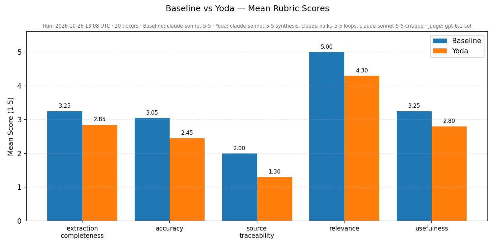

# Yoda — Pre-Earnings Research Assistant

---
## 1. Context, User, and Problem

**Who:** A buy-side or sell-side analyst who covers 10–50 tickers and prepares for earnings calls individually, often the week(s) leading up to the earnings call.

**The workflow being improved:** Pre-earnings research. Before every earnings call, an analyst reads the most recent 10-Q or 10-K, pulls consensus estimates, scans recent news, and assembles a one-page dossier: key metrics, segment trends, forward guidance, risk flags, and what to watch. This typically takes 60–90 minutes per ticker and is done manually, tab by tab.

**Why it matters:** Earnings surprise is one of the highest-signal events in equity analysis, and analyst preparation directly affects how quickly they can react. The bottleneck is not judgment — it is assembly time: fetching the right SEC filing section, locating a specific guidance quote, cross-checking segment revenue against prior quarters. A system that automates citation-backed assembly frees the analyst to focus on the 10% that is genuinely interpretive.

**The failure mode we are solving for:** Generic LLM summaries of earnings filings hallucinate figures and drop citations. An analyst cannot use a report that might be fabricated. Every claim in Yoda must carry a source citation (section name + chunk ID from the filing, or API name + timestamp for external data); anything that cannot be cited goes into a visible `data_gaps` list rather than being silently invented.

---

## The `/research` Command (Dev Tool)

This repo ships a project-level Claude Code slash command at `.claude/commands/research.md`. It speeds up high-quality learning while coding and counters shallow research by running a fixed 5-pass routine: (1) define the core concepts, (2) web-search to map the field then fetch and read the real pages (not just snippets), (3) lay out the main approaches and what distinguishes them, (4) weigh realistic options against *this* repo by reading PLAN.md / README and the relevant code, and (5) output a comparison table plus a short list of open questions. It deliberately stops there — no single recommendation, no implementation plan.

**Usage:** inside a Claude Code session in this repo, run:

```
/research <topic or question>
```

Example: `/research local embedding models to replace text-embedding-3-small`

---

## 2. Solution and Design

Yoda fetches the company's recent SEC filings — a 10-Q filed in the last 18 weeks and/or an annual report (10-K, or a foreign company's 20-F or 40-F) filed in the last 13 months; both are read when both are in range, except a 10-Q older than the annual report — from SEC EDGAR for a given ticker, chunks each filing by section, embeds and indexes them in a local ChromaDB vector store using OpenAI `text-embedding-3-small` (1536-dim, ~$0.004/filing), enriches with analyst consensus and news, and generates a structured `EarningsReport` via a multi-agent personality panel. The report downloads as a PDF; a Queue tab batches multiple tickers and bundles the PDFs into a ZIP.

### How Yoda Works

Yoda runs a six-personality panel via `yoda/modes/personality_panel.py`. Six personalities (Optimist, Pessimist, Conservative, Dreamer, Contrarian, Quant) each run parallel tool-use loops on Claude Haiku 5.5 (up to 6 tool calls; after 45s a personality stops calling tools and writes up what it has), followed by a cross-critique phase where each personality emits SUPPORTS / CHALLENGES / EXTENDS messages on its peers' hypotheses. A deterministic filter retains/contests/drops hypotheses, then Claude Sonnet 5.5 synthesizes a final report that surfaces contested items inside the watchlist. Typical latency: ~3 minutes per ticker — about two-thirds of it is the Sonnet synthesis call, which thinks at high effort before writing the report.

Each personality uses four tools: `retrieve_filing` (semantic search across the 10-Q and the annual report, whichever were read, and the 8-Ks filed since), `search_news` (Tavily web search from the filing date on — all URLs accumulate into a shared news pool), `read_article` (the full text of a news-pool article), and `lookup_peer` (fetch + chunk + search a competitor's filing on demand). The synthesizer then reads the full filing, the full 8-K text, the market data and the articles the personalities read, and writes a structured `EarningsReport` whose watchlist items each carry 0–3 starting-point URLs drawn from that shared pool, validated against it so synthesis cannot invent links. Post-filing developments go in a separate `since_filing` section, each claim checked to link to a real 8-K or news-pool article; `market_expectations` is filled in code straight from the market data.

### Key Design Choices

| Choice | Rationale |
|---|---|
| Claude Sonnet 5.5 for synthesis + critique, Claude Haiku 5.5 for personality loops | Accuracy where it counts; cost control in the 6× parallel loops. Chosen by a spot check (AAPL/JPM/XOM): a Sonnet critique scored slightly above all-Haiku for ~$0.13/report more, while all-Sonnet cost 3.4× as much for no gain |
| Six-personality panel + typed cross-critique | Forces the report to consider divergent lenses (optimism, skepticism, balance-sheet, long-horizon, contrarian, quant) before synthesizing one analyst voice; cross-critique flags contested claims for the watchlist |
| 10-Q + annual report ingest, read as equals | The 10-Q has the freshest quarterly data; the 10-K (or 20-F / 40-F) is often the more complete document. Each counts within its own window (18 weeks / 13 months); a 10-Q older than the annual report is not read |
| Finnhub consensus with FMP backup | Finnhub free tier is sparse; `yoda/tools/consensus.py` falls back to FMP when Finnhub returns nothing |
| ChromaDB persistent client (`filings_openai` collection) | No native deps on Windows; cosine-distance index over 1536-dim OpenAI vectors |
| `reportlab` for PDF (not weasyprint) | weasyprint requires GTK3/Pango/Cairo native libs on Windows; reportlab is pure Python |
| Cite-or-skip rule + URL-pool validation | Any uncitable fact goes to `data_gaps`; every news URL and watchlist URL is validated against the investigation's news pool so synthesis cannot fabricate links |
| Filing-only `source_citation` enforcement | `key_metrics`, `revenue_segments`, `key_risks`, and `forward_guidance` source citations are restricted to filing section labels — a post-synthesis check replaces any citation containing a URL or pointing to an 8-K with `UNVERIFIED — the cited source was not the filing` and adds a `data_gaps` entry naming the item, and the chunk-heading extractor rejects mid-word fragments so the judge can verify traceability |
| OpenAI `gpt-6.1-sol` as eval judge | Different model family from the Claude-based generation system; prevents self-preference bias in scoring. Sol is OpenAI's counterpart to Sonnet 5.5 |
| Embed only filings not already stored | ChromaDB is checked first; a filing is embedded only when its stored chunk count differs from its current one (new, half-stored, or re-chunked) |

> **`UNVERIFIED` vs `unverifiable` — two different labels.** `UNVERIFIED` is the citation label above: a filing figure whose citation pointed outside the filing. `unverifiable` is an evidence tag (`next_steps.txt` 3.2): a claim whose source does not say where the claim came from, or one code could not check against what the panel was shown. The eval judge will treat it the same way — a claim whose source is not in the evidence the judge sees is listed as unverifiable, not counted as an error.

> **8-K figures.** Figures from 8-K earnings releases appear in the report's since_filing section, tagged reported with the period they cover. They are never placed in key_metrics, which holds only figures from the 10-Q/10-K.

### Architecture

```
┌──────────────────────────────────────────────────────────────────────────┐
│                              Yoda App                                    │
│                                                                          │
│  ┌──────────────────┐  ┌──────────────────┐  ┌──────────────────────┐    │
│  │ Single Ticker    │  │ Queue (batch)    │  │ Eval Harness         │    │
│  │ Streamlit tab    │  │ Streamlit tab    │  │ yoda/eval/runner.py  │    │
│  │ Yoda             │  │ many → ZIP       │  │ + judge.py           │    │
│  └────────┬─────────┘  └────────┬─────────┘  └──────────┬───────────┘    │
│           │                     │                       │                │
│           ▼                     ▼                       │                │
│  ┌────────────────────────────────────────────────┐     │                │
│  │              Ingest + Retrieval                │     │                │
│  │  edgar.py     chunker.py    embeddings.py      │     │                │
│  │  (10-Q + 10-K) (section-aware) (ChromaDB)      │     │                │
│  └──────────────────────┬─────────────────────────┘     │                │
│                         │                               │                │
│                         ▼                               │                │
│  ┌────────────────────────────────────────────────┐     │                │
│  │           Personality Panel (Phase 10)         │     │                │
│  │  Optimist   Pessimist   Conservative           │     │                │
│  │  Dreamer    Contrarian  Quant                  │     │                │
│  │  (Haiku 5.5 loops · Sonnet 5.5 critique)       │     │                │
│  │                                                │     │                │
│  │  Tools: retrieve_filing · search_news ·        │     │                │
│  │         lookup_peer                            │     │                │
│  └──────────────────────┬─────────────────────────┘     │                │
│                         │                               │                │
│                         ▼                               │                │
│  ┌────────────────────────────────────────────────┐     │                │
│  │  Cross-Critique + Synthesis                    │     │                │
│  │  Sonnet 5.5 → EarningsReport (Pydantic)        │     │                │
│  └──────────┬─────────────────────┬───────────────┘     │                │
│             │                     │                     │                │
│             ▼                     ▼                     ▼                │
│  ┌──────────────────┐  ┌──────────────────┐  ┌──────────────────────┐    │
│  │ PDF (reportlab)  │  │ data/reports/    │  │ Judge                │    │
│  │ data/reports/    │  │ data/filings/    │  │ gpt-6.1-sol          │    │
│  │   {TICKER}.pdf   │  │ data/eval/       │  │ data/eval/judge_*    │    │
│  └──────────────────┘  └──────────────────┘  └──────────────────────┘    │
│                                                                          │
└──────────────────────────────────────────────────────────────────────────┘
                                    │
                                    ▼
        ┌──────────────────────────────────────────────────┐
        │  External APIs                                   │
        │  Anthropic (Sonnet 5.5, Haiku 5.5 — generation)  │
        │  OpenAI (judge, embeddings)   SEC EDGAR          │
        │  Finnhub + FMP (consensus)   Tavily (news)       │
        └──────────────────────────────────────────────────┘
```

```
app.py (Streamlit — Single ticker + Queue tabs)
    ├── yoda/ingest/edgar.py             # SEC EDGAR fetch + disk cache (recent 10-Q and annual report)
    ├── yoda/ingest/chunker.py           # section-aware HTML → text chunks
    ├── yoda/retrieval/                  # text-embedding-3-small + ChromaDB
    ├── yoda/tools/consensus.py          # Finnhub + FMP backup
    ├── yoda/tools/news.py               # Tavily search
    ├── yoda/modes/personality_panel.py  # Phase 10: 6-personality panel
    ├── yoda/modes/tools.py              # tool registry shared across personalities
    ├── yoda/modes/baseline.py           # Single-pass baseline (eval lower bound)
    ├── yoda/queue/processor.py          # Batch processor: many tickers → ZIP
    ├── yoda/schema.py                   # EarningsReport + WatchItem Pydantic models
    ├── yoda/report/pdf.py               # EarningsReport → PDF (reportlab)
    └── yoda/eval/                       # Model-as-judge eval harness
```

---

## 3. Evaluation and Results

### Evaluation Scope

By default, `run_eval()` evaluates against a **curated 20-ticker universe**: two per sector/archetype, with the second chosen to be structurally different from the first, so the eval covers diverse filing structures and business narratives. Twenty (not ten) because the stronger single-pass baseline is expected to narrow the gap to Yoda, and smaller gaps need more tickers to tell apart from judge noise.

| Sector | Tickers |
|---|---|
| Tech — hardware / platforms | AAPL, MSFT |
| Tech — semiconductors | NVDA, AMD |
| Consumer discretionary / retail | AMZN, HD |
| Financials | JPM (money-center bank), USB (regional bank) |
| Healthcare | JNJ (pharma + medtech), UNH (managed care) |
| Energy | XOM (integrated major), SLB (oilfield services) |
| Consumer staples | KO, PG |
| Media / streaming | NFLX, DIS |
| Industrials | CAT, BA |
| Software | PANW (cybersecurity), CRM (SaaS) |

Each ticker runs against two modes: `baseline` and `yoda`. To evaluate a custom set:
```bash
python -m yoda.eval.runner NFLX AAPL JPM  # Custom tickers
python -m yoda.eval.runner NFLX            # Single ticker (quick test)
```

**Cost / Latency** (measured on the 2026-10-26 full run): the baseline averages ~$0.31 and ~58s per ticker (more for very long filings — JPM's ~210K-token 10-Q costs ~$0.85), Yoda ~$0.43 and ~2.8 min. A full 20-ticker run is ~$15 of generation plus ~$1–2 of judging, ~75 min. A single ticker is ~$0.75 and ~4 min.

### Modes Compared

- **`baseline`** — Single-pass (`yoda/modes/baseline.py`): "here are the SEC filings; write a pre-earnings research brief." One Claude Sonnet 5.5 call receives the **full text** of the same filings Yoda reads (the recent 10-Q and/or annual report) and returns the report in one response. No retrieval, no news, no agent loop, no second pass. Its only instruction beyond the report format is the citation rule; since it gets no news, any news items or URLs it returns are stripped in code. It reads the same filings Yoda reads, so the comparison measures what Yoda's extra steps add — not how much filing text each side saw.
- **`yoda`** — Full personality panel (Haiku 5.5 loops, Sonnet 5.5 critique and synthesis) with OpenAI `text-embedding-3-small` for retrieval. Vectors stored in the `filings_openai` Chroma collection.

### Rubric

Reports are scored by OpenAI `gpt-6.1-sol` through `yoda/eval/judge.py` — a different model family from the Claude models that write the reports, so the judge can't favour its own family's output. The judge sees the report JSON plus **only the first 30,000 characters of the filing**, so it cannot verify facts from later in long filings; keep this in mind when reading the accuracy and traceability scores. Judge outputs are cached under `data/eval/judge_cache/` so re-runs are free; a manifest written per run lets `prune_judge_cache(keep_runs=2)` keep only the two most recent runs' cached files. Each report is scored on five dimensions, rated 1–5:

| Dimension | What it measures |
|---|---|
| **Extraction completeness** | Did the report extract the key facts actually available in the filing? |
| **Accuracy** | Are the figures correct relative to the source filing? |
| **Source traceability** | Do citations resolve to real sections or chunks? |
| **Relevance** | Is the content focused on pre-earnings analysis? |
| **Usefulness** | Would a sell-side analyst find this actionable before an earnings call? |

### Test Set

Twenty US-listed stocks, two per sector/archetype (see the table above), all with at least 3 years of public trading history. See [`CURATED_TICKERS` in `yoda/eval/runner.py`](yoda/eval/runner.py) for the source list.

### Results

**Last run: 2026-10-26** — 20 tickers × 2 modes, filings refreshed from SEC the same day. Generation: Claude Sonnet 5.5 (baseline, Yoda synthesis + critique) and Haiku 5.5 (Yoda loops). Judge: `gpt-6.1-sol`.

| Mode | Extraction | Accuracy | Traceability | Relevance | Usefulness | Latency | Cost |
|---|---|---|---|---|---|---|---|
| Baseline (single-pass) | 3.25 | 3.05 | 2.00 | 5.00 | 3.25 | 58s | $0.31 |
| Yoda (panel) | 2.85 | 2.45 | 1.30 | 4.30 | 2.80 | 167s | $0.43 |

**On this rubric, the single-pass baseline beats Yoda.** Paired by ticker, Yoda's average score is 0.57 lower (95% bootstrap range −0.75 to −0.39, entirely below zero), and Yoda won 1 of 20 tickers, tied 2, lost 17. The biggest gaps are source traceability and relevance (−0.7 each) and accuracy (−0.6).

How to read this: the current rubric measures how well a report extracts and cites facts **from the filing**, and the judge sees only the filing's first 30K characters — exactly the single-pass baseline's strength, since it reads the full filings directly while Yoda's synthesis sees ~14 retrieved chunks. It does not measure what Yoda adds (current news, peer comparison, market expectations). Next steps already planned: rebuild the rubric around Yoda's purpose as a pre-earnings brief (market expectations including consensus and whisper numbers, reasoning over dated news, usefulness to sell- and buy-side analysts), and close the filing gaps (full filing in synthesis, filing-matched citations). This run's 40 reports are archived so they can be re-scored under the new rubric.



Full per-ticker results and the paired confidence table are in [`data/eval/summary.md`](data/eval/summary.md) and [`data/eval/results.csv`](data/eval/results.csv). The complete run — all 40 report JSONs plus these outputs — is archived in [`data/eval/archive_2026-10-26_claude-panel_old-rubric/`](data/eval/archive_2026-10-26_claude-panel_old-rubric/).

---

## 4. Artifact Snapshot

### UI Flow

The app has two tabs: **Single ticker** (interactive, one report at a time) and **Queue (batch)** (paste many tickers, generate overnight, download all PDFs as a ZIP).

```
┌─────────────────────────────────────────────────┐
│  Yoda — Pre-Earnings Research Assistant          │
│  [ Single ticker ] [ Queue (batch) ]             │
│                                                  │
│  Ticker  [  NFLX                  ]              │
│                                                  │
│  [  Generate Report  ]                           │
└─────────────────────────────────────────────────┘
           ↓ (on click)
┌─────────────────────────────────────────────────┐
│  ⏳ Generating report for NFLX...                │
│  ┌───────────────────────────────────────────┐  │
│  │ [panel] Fetching filing for NFLX...       │  │
│  │ [panel] Filing: 10-Q 2026-04-18           │  │
│  │ [panel] Supplemental: 10-K 2026-...       │  │
│  │ [panel] Phase 2: 6 personalities...       │  │
│  │ [Optimist] iter 1: retrieve_filing(...)   │  │
│  │ [Pessimist] iter 1: search_news(...)      │  │
│  │ [Quant]    iter 2: lookup_peer('DIS',...) │  │
│  │ [panel] Phase 4: synthesizing...          │  │
│  └───────────────────────────────────────────┘  │
└─────────────────────────────────────────────────┘
           ↓ (complete)
┌─────────────────────────────────────────────────┐
│  NFLX — Netflix, Inc.                            │
│  10-Q filed 2026-04-18 · 10-K filed 2026-01-29   │
│                                                  │
│  [  Download PDF Report  ]                       │
│                                                  │
│  Pre-Earnings Watchlist                          │
│   **Ad-tier ARPU:** ...                          │
│   -> Monitor ad-tier ARPU disclosure             │
│   - https://reuters.com/...                      │
│   - https://wsj.com/...                          │
│                                                  │
│  ▶ Bull Case / Bear Case                         │
│  ▶ Recent News (8)                               │
│  ▶ Data Gaps (2)                                 │
└─────────────────────────────────────────────────┘
```

### Sample Report Fields (NFLX)

```json
{
  "ticker": "NFLX",
  "company_name": "Netflix, Inc.",
  "filings": [
    {"filing_type": "10-Q", "filing_date": "2026-04-18", "url": "https://www.sec.gov/Archives/..."},
    {"filing_type": "10-K", "filing_date": "2026-01-29", "url": "https://www.sec.gov/Archives/..."}
  ],
  "key_metrics": [
    {
      "name": "Total Revenue",
      "value": "$12,249,757K",
      "unit": "",
      "source_citation": "Financial Statements — Consolidated Statements of Operations"
    }
  ],
  "forward_guidance": {
    "text": "Management expects continued margin expansion driven by advertising tier growth...",
    "source_citation": "MD&A — Outlook"
  },
  "what_to_watch": [
    {
      "text": "**Ad-tier ARPU:** Advertising-tier ARPU grew 18% YoY against a backdrop of cooling subscriber adds. However, mix-shift toward lower-priced ad-supported plans could mask underlying pricing softness.\n\n-> Monitor ad-tier ARPU disclosure and ad-impression growth commentary.",
      "relevant_urls": [
        "https://www.reuters.com/business/media-telecom/netflix-ad-tier-growth-2026-04-18",
        "https://www.wsj.com/articles/netflix-advertising-arpu-2026"
      ]
    }
  ],
  "data_gaps": [
    "Paid net additions not disclosed — subscriber metric absent from MD&A this quarter"
  ]
}
```

### PDF Output Structure

The downloaded PDF contains: cover page (ticker, company name, each filing read with its date, and which earnings call was read, e.g. "Earnings call: Q3 FY2026 (2026-10-27)"), the Pre-Earnings Watchlist (each entry followed by clickable "Sources:" URLs when the synthesizer found relevant news in the pool), market expectations (consensus, whisper, implied and historical move, beat/miss record, analyst actions, price target — each with its quarter, source and date, and N/A with the reason when missing), information beyond the filing (8-K events, what the company said on its latest earnings call, news — each claim with its evidence type, period, date and a link to its source; an analyst's words on the call are never presented as the company's), key metrics table (each figure with the period it covers), revenue segments table, forward guidance blockquote, key risks (new risks flagged in red), recent news with hyperlinks, bull/bear bullets, and data gaps in amber. The app shows market expectations and developments since the filing in two expanders under the watchlist.

**Advanced search settings.** Before searching, the app checks the ticker's next earnings date (a free call). The paid whisper-number lookup (about $0.12–0.15) is ticked only when that report is 3 days away or less, because whisper numbers are published only a day or two before. An unknown date leaves it unticked. You can tick or untick it yourself. In the queue, each ticker follows the same rule from its own date, or you can skip whisper lookups for the whole batch. The eval runner and the command-line smoke tests apply the same rule.

---

## 5. Setup and Usage

### Prerequisites

- Python 3.11+
- Conda (recommended) or virtualenv
- API keys for Anthropic, OpenAI, Finnhub, FMP, and Tavily

### Installation

```bash
# Clone the repo
git clone <repo-url>
cd Yoda

# Create and activate a conda environment (or use virtualenv)
conda create -n yoda python=3.11
conda activate yoda

# Install dependencies
pip install -r requirements.txt

# Copy the env template and fill in your keys
cp .env.example .env
```

Edit `.env` with your keys:

```
OPENAI_API_KEY=sk-...
ANTHROPIC_API_KEY=sk-ant-...
FINNHUB_API_KEY=...
FMP_API_KEY=...
TAVILY_API_KEY=tvly-...
SEC_USER_AGENT="Your Name your@email.com"
```

### Run the App

```bash
streamlit run app.py
```

Open [http://localhost:8501](http://localhost:8501), enter a ticker (e.g. `NFLX`) and click **Generate Report**. For batch runs, switch to the **Queue (batch)** tab, paste multiple tickers (one per line or comma-separated), and run them sequentially — PDFs save to `data/reports/` as they complete and bundle into a downloadable ZIP at the end.

The first run for a ticker fetches and indexes the SEC filings — a 10-Q filed in the last 18 weeks and/or an annual report (10-K, or a foreign company's 20-F or 40-F) filed in the last 13 months. Subsequent runs for the same ticker are fast because the filings and ChromaDB index are cached to disk.

### Run the Evaluation Harness

```bash
# Single ticker (cheap verification, ~$0.60, ~4 min)
python -m yoda.eval.runner NFLX

# Full curated 20-ticker run (see Cost / Latency in section 3)
python -m yoda.eval.runner
```

Outputs `data/eval/results.csv`, `data/eval/summary.md` (headed with the run date and models, and including the paired Yoda-vs-baseline confidence table), and `data/eval/comparison.png` (subtitled with the same run line). Judge results are cached in `data/eval/judge_cache/` so repeated runs are free; only the two most recent runs' cached files are kept on disk.

**What the judge reads** (`yoda/eval/evidence.py`). The judge reads the evidence each report was written from, saved as `{mode}_{ticker}_evidence.json`:
- **Yoda:** the 10-Q/10-K, the 8-Ks, the market data, the news results and the articles read.
- **The baseline (for now):** the filing(s) it read.

The report is judged without `hypotheses_explored`. To stay under the judge's 272K-token price line:
- 8-K documents the report doesn't cite are shortened to their first 2,000 characters;
- if the prompt is still too long, uncited news snippets are dropped;
- the judge is told what was left out;
- a prompt still over the line is sent and flagged.

Dimensions a mode had no evidence for (e.g. market expectations for the baseline) are marked N/A by code.

**Judge reliability.** Each row of `results.csv` records:
- the judge version OpenAI reports;
- the prompt and completion tokens, and whether the prompt went over 272K;
- an upper-bound judge cost ($2 / $10 per million tokens, cache discount not applied);
- the dimensions whose quoted passages weren't found;
- the report's length.

`summary.md` warns when judge versions are mixed or differ from the previous run, and shows:
- failed quotes per dimension;
- the length-vs-score correlation (Spearman);
- for the Yoda-vs-baseline comparison and the chart, only tickers where both modes were scored on a dimension.

`justifications.md` lists a few of the judge's justifications per dimension. To judge reports already on disk without running the modes again (every uncached judge call is paid):

```bash
python -m yoda.eval.runner --rescore data/eval/archive_2026-10-26_claude-panel_old-rubric NFLX JPM
```

```bash
python -m yoda.eval.runner --rescore data/eval --repeat AAPL JPM NFLX
```

The first re-scores archived reports against the filing they were written from, skipping any whose filing has changed since. The second scores the same reports a second time and adds a repeat-agreement table.

Cache cleanup at the end of every run:
- `data/eval/{mode}_{TICKER}.json` — one report JSON per `(mode, ticker)` (overwrites older copies)
- `data/eval/judge_cache/` — JSON cache files from the two most recent runs only (older are pruned via run manifests)
- `data/reports/{TICKER}_{ts}.pdf` — one PDF per ticker (older are deleted)
- `data/queue_zips/yoda_queue_{ts}.zip` — at most the two most recent ZIP bundles

### Run the Tests

```bash
python -m pytest -q
```

The offline suite in `tests/test_offline.py` makes no API calls and costs nothing. It covers the logic that can break silently: citation checks, cost math, the judge cache key, tool schemas, the baseline prompt, the embedding skip, the panel's failure and time-cap handling, and the paired comparison. It needs a `.env` with keys present (importing `yoda.config` checks them). Run it from the repo root with `python -m pytest` so the `yoda` package is importable.

### Run Individual Mode Smoke Tests

```bash
# Multi-agent personality panel — current production mode
python -m yoda.modes.personality_panel NFLX

# Single-pass baseline (eval lower bound)
python -m yoda.modes.baseline NFLX

# PDF generation from a saved report JSON (default mode: yoda)
python -m yoda.report.pdf NFLX
```

---

## Required API Keys

| Variable | Required | Purpose |
|---|---|---|
| `ANTHROPIC_API_KEY` | Yes | All report generation: Claude Sonnet 5.5 (synthesis, critique, baseline) and Claude Haiku 5.5 (personality loops) |
| `OPENAI_API_KEY` | Yes | Filing embeddings (`text-embedding-3-small`) and the eval judge (`gpt-6.1-sol`) |
| `FINNHUB_API_KEY` | Yes | Analyst consensus estimates (primary source) |
| `FMP_API_KEY` | Yes | Financial Modeling Prep — backup source when Finnhub returns no consensus |
| `TAVILY_API_KEY` | Yes | News and web search |
| `ALPHAVANTAGE_API_KEY` | Yes | Earnings call transcripts (free key from alphavantage.co; about 25 requests a day, transcripts cached in `data/transcripts/`) |
| `SEC_USER_AGENT` | Yes | SEC EDGAR requires a contact string, e.g. `"Name email@example.com"` |

---

## Repo Structure

```
yoda/
├── app.py                              # Streamlit entry point (Single ticker + Queue tabs)
├── requirements.txt
├── .env.example
├── yoda/
│   ├── config.py                       # env vars + Claude price table (MODEL_COST_PER_1K)
│   ├── ingest/
│   │   ├── edgar.py                    # ticker -> SEC EDGAR fetch (recent 10-Q and annual report)
│   │   └── chunker.py                  # section-aware chunking
│   ├── retrieval/
│   │   ├── embeddings.py               # OpenAI text-embedding-3-small
│   │   └── vector_store.py             # ChromaDB wrapper — filings_openai collection
│   ├── tools/
│   │   ├── consensus.py                # Finnhub + FMP backup
│   │   └── news.py                     # Tavily wrapper
│   ├── modes/
│   │   ├── personality_panel.py        # Phase 10: 6-personality panel
│   │   ├── tools.py                    # Tool registry (retrieve_filing, search_news, lookup_peer)
│   │   └── baseline.py                 # Single-pass baseline (eval lower bound)
│   ├── queue/
│   │   └── processor.py                # Batch queue processor + ZIP bundler
│   ├── schema.py                       # EarningsReport + WatchItem Pydantic models
│   ├── report/
│   │   └── pdf.py                      # EarningsReport -> PDF (reportlab)
│   └── eval/
│       ├── rubric.py                   # rubric Pydantic models
│       ├── judge.py                    # gpt-6.1-sol model-as-judge
│       └── runner.py                   # batch eval over test tickers
├── data/
│   ├── filings/{TICKER}/               # cached filing HTML (one file per filing) + latest.json (gitignored)
│   ├── chroma/                         # ChromaDB persistence — filings_openai collection (gitignored)
│   ├── reports/                        # PDFs written by the Queue processor, 1 per ticker (gitignored)
│   ├── queue_zips/                     # ZIP bundles from queue runs, max 2 most recent (gitignored)
│   └── eval/                           # eval outputs: results.csv, summary.md, comparison.png, judge_cache/ (last 2 runs)
├── .claude/commands/research.md        # project-level /research slash command (dev tool)
├── .claude/worktrees/                  # working trees from /worktree development (gitignored)
└── tests/
    └── test_offline.py                 # offline pytest suite (no API calls)
```

---

## APIs and Keys

API keys are stored as environment variables (`.env`) and excluded from the repo via `.gitignore`. See `.env.example` for the full template.
