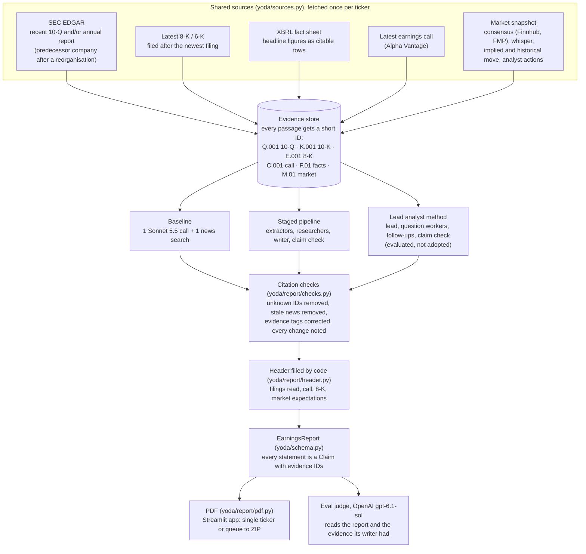
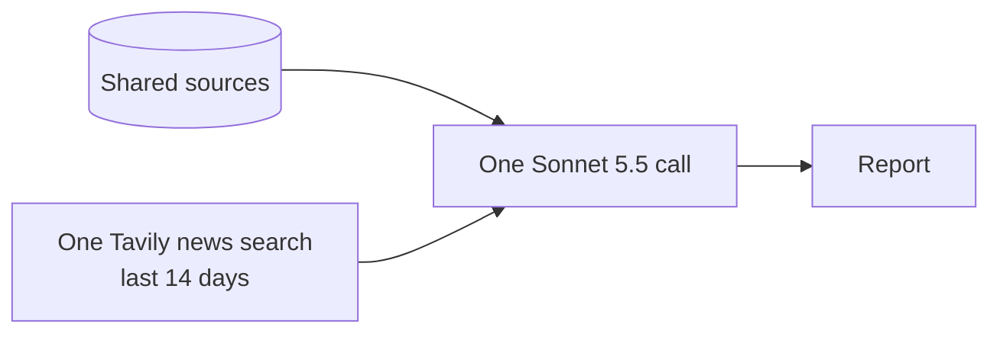
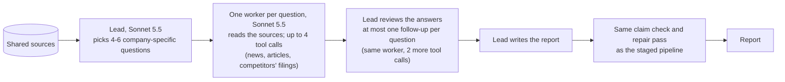
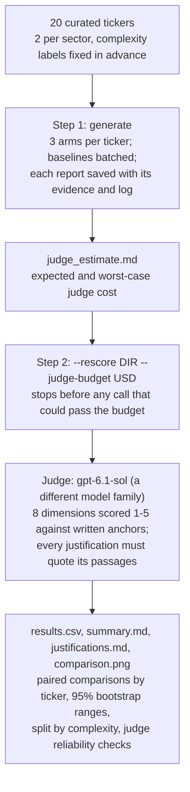

# Yoda: Architecture

How a Yoda report is produced, and how the three report-writing methods ("arms") were compared. The diagrams are [Mermaid](https://mermaid.js.org/), which GitHub draws on this page. For the results, see the [README](../README.md#2-results-full-evaluation-2026-11-01).

## 1. The system at a glance

Every arm reads the **same shared sources**, fetched once per ticker, so a difference in scores comes from the method, not from what each arm was allowed to see. Each arm writes the same report schema, and code checks every citation before the report is saved.

## 2. The staged pipeline

The mode the app runs today (`yoda/modes/pipeline.py`). Fixed stages, the way an analyst prepares an earnings preview. About $1.37 and 6 minutes per report in the full evaluation.

```mermaid
flowchart LR
    SRC[("Shared sources<br/>cached once, read by every Sonnet call")]
    SRC --> FX["Filing extractor<br/>Sonnet 5.5<br/>notes on the 10-Q / 10-K"]
    SRC --> PX["Post-filing extractor<br/>Sonnet 5.5<br/>notes on the 8-K and the call"]
    SRC --> NR["News researcher<br/>Haiku 5.5 tool loop<br/>search_news, read_article"]
    SRC --> PR["Peers researcher<br/>Haiku 5.5 tool loop<br/>lookup_peer (competitors' filings)"]
    FX --> W["Writer<br/>Sonnet 5.5"]
    PX --> W
    NR --> W
    PR --> W
    W --> CC["Claim check<br/>Haiku 5.5 reads each claim beside its passages;<br/>Sonnet 5.5 second opinion on the ones it fails"]
    CC --> RP["One repair pass<br/>rewrites or deletes claims both checkers fail;<br/>rewritten claims are checked again"]
    RP --> OUT["Report"]
```

What the researchers find (news results, articles, competitor passages) is added to the evidence store, so it can be cited and the judge sees it.

## 3. The baseline

`yoda/modes/baseline.py`. What an analyst gets by pasting the sources into a chatbot: one prompt holding the shared sources and the results of **one** generic news search ("&lt;company&gt; &lt;ticker&gt; earnings", last 14 days), and one response. No agent loop, no claim check, no second pass. Many tickers go through Anthropic's Batch API at half price. About $0.35 per report.

The same citation checks run on its report as on every other arm's.

## 4. The lead analyst method (evaluated, not adopted)

`yoda/modes/lead.py`. Kept so the evaluation can be reproduced. It scored below both other arms and cost the most (about $3.00 and 9 minutes per report).

## 5. The evaluation harness

`yoda/eval/runner.py`, in two commands so the judge's cost is seen before it is spent.

## 6. Cost controls built into both candidate methods

- **Prompt caching.** The shared sources are the first system block of every Sonnet call that reads them, marked as a cache breakpoint, so they are written to Anthropic's cache once (at 1.25 times the input price) and read at a twentieth of it afterwards. The cache lives 5 minutes, and a keep-alive request re-reads it every 4 minutes for the rest of the report (`source_calls.keep_cache_alive`). None of the 40 candidate reports in the full evaluation had a keep-alive miss. `yoda/prompt_cache.py` proves offline that the requests share one cache entry.
- **Batching.** Baselines go through the Batch API at half price.
- **Cheaper models where they are enough.** Haiku 5.5 runs the research loops and the first claim-check pass; Sonnet 5.5 writes and gives the second opinion.
- **Usage logged per stage.** Every stage prints its tokens and cost, so each report's log shows where its money went.
